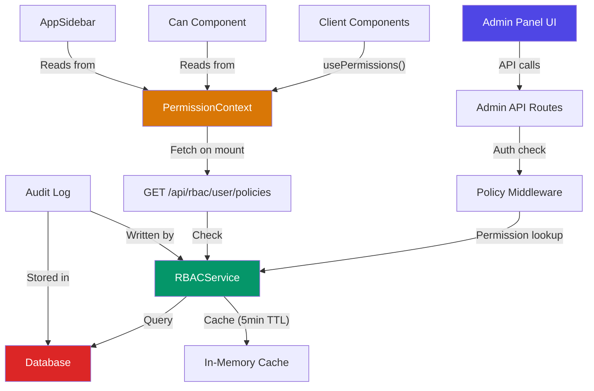
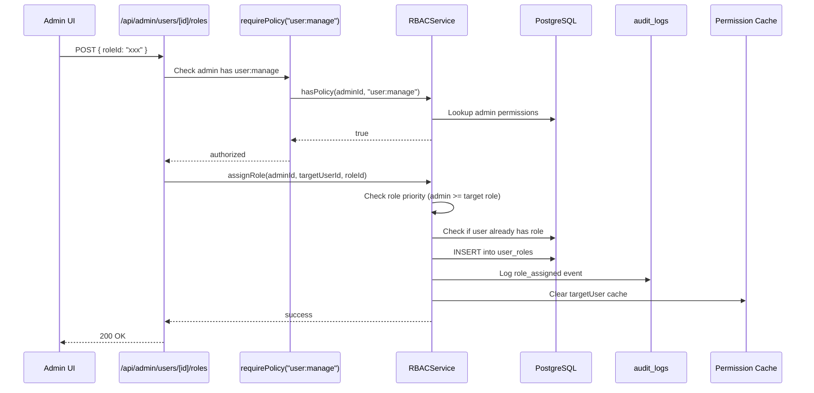

# Advanced RBAC Admin Panel — Implementation Plan

A comprehensive overhaul of the existing RBAC system to give admins full, dynamic control over users, roles, permissions, and feature access — all from the admin panel UI, with no code changes required for new roles/permissions.

## Background & Problem Statement

The current RBAC system in AuthPay has a solid foundation:
- **Database schema**: `users`, `roles`, `permissions`, `user_roles`, `role_permissions` tables already exist with proper relations
- **Backend service**: [RBACService](file:///d:/Pratik/Dev/Projects/AuthPay/src/lib/rbac/rbac-service.ts) provides `hasPolicy`, `hasAnyPolicy`, `hasAllPolicies`, `assignRole`, `removeRole`
- **API middleware**: [policy-middleware.ts](file:///d:/Pratik/Dev/Projects/AuthPay/src/lib/rbac/policy-middleware.ts) has `requirePolicy`, `requireAnyPolicy`, `requireAdmin`
- **Route protection**: [routing-utils.ts](file:///d:/Pratik/Dev/Projects/AuthPay/src/lib/rbac/routing-utils.ts) has `ROUTE_POLICIES` mapping and `getAuthorizedRoute`

**However**, it suffers from critical limitations:

1. **Hardcoded admin detection** — `isAdmin()` checks role name string (`"admin"`, `"Admin"`, `"Administrator"`) rather than checking permissions
2. **Static policy definitions** — Policies are hardcoded as constants in [index.ts](file:///d:/Pratik/Dev/Projects/AuthPay/src/lib/rbac/index.ts#L51-L108) instead of being database-driven
3. **No permission management UI** — The [AdminRolesPage](file:///d:/Pratik/Dev/Projects/AuthPay/src/components/admin/AdminRolesPage.tsx) can create/delete roles but **cannot assign or manage permissions on those roles**
4. **Legacy user-roles page** — [AdminUserRolesPage](file:///d:/Pratik/Dev/Projects/AuthPay/src/components/admin/AdminUserRolesPage.tsx) still uses a simple admin/user dropdown with hardcoded `roleOptions`
5. **No permission inheritance** — No `*:manage` → implies `*:view`, `*:create`, `*:update`, `*:delete`
6. **No audit trail for RBAC changes** — Role assignments/removals are not logged to `audit_logs`
7. **Static sidebar navigation** — [AppSidebar](file:///d:/Pratik/Dev/Projects/AuthPay/src/components/layout/AppSidebar.tsx) shows admin items based only on `isAdmin` boolean, not on actual policies
8. **No client-side permission guards** — No `<Can policy="user:manage">` component or `usePermissions()` hook for conditional UI rendering
9. **No "Super Admin" protection** — Any admin can demote another admin, including themselves
10. **Missing "create admin" flow** — No dedicated flow for creating new admins with confirmation and audit trail

---

## User Review Required

> [!IMPORTANT]
> **Super Admin Concept**: This plan introduces a `Super Admin` system role that has **immutable, full access** and cannot be modified or removed by other admins. This is the initial seed admin (you). Other admins can be created by Super Admin/Admin users but will be governed by their assigned permissions. **Do you want this hierarchy, or should all admins be equal?**

> [!WARNING]
> **Breaking Change: `isAdmin()` Behavior**: Currently `isAdmin()` matches role names "admin"/"Admin"/"Administrator". This plan changes it to check for the `admin:access` policy instead. Existing admin users must have the `admin:access` permission assigned to their role, or they lose access. The migration script will handle this automatically, but it's a fundamental behavior change.

> [!IMPORTANT]
> **Permission Inheritance**: This plan proposes that `resource:manage` implies all CRUD permissions for that resource (`resource:view`, `resource:create`, `resource:update`, `resource:delete`). Should we implement this, or keep permissions flat and explicit?

---

## Open Questions

> [!IMPORTANT]
> 1. **Role Hierarchy**: Should roles have a numeric `priority` level where higher-priority roles can't be modified by lower ones? (e.g., Super Admin=100, Admin=80, Moderator=50, User=10). This prevents an admin from promoting themselves to Super Admin.
> 2. **Permission Categories for UI**: The current schema has a `category` field on permissions. Should the admin panel group permissions by category (e.g., "User Management", "Billing", "Content") in a tree-view, or show them as a flat list?
> 3. **Maximum Roles per User**: Should there be a limit on how many roles a user can have simultaneously?
> 4. **Role Templates**: Should we add a "clone role" feature that duplicates an existing role and its permissions as a starting point?

---

## Proposed Changes

### Phase 1: Database & Schema Enhancements

Add role hierarchy support and ensure the schema supports all needed features.

---

#### [MODIFY] [schema.ts](file:///d:/Pratik/Dev/Projects/AuthPay/src/server/db/schema/schema.ts)

- Add `priority` (integer, default 0) to the `roles` table — higher = more privileged
- Add `isSuperAdmin` (boolean, default false) to the `roles` table — immutable Super Admin flag
- Add unique constraint on `role_permissions(role_id, permission_id)` to prevent duplicates (currently missing)

```diff
 export const roles = pgTable("roles", {
   id: uuid('id').defaultRandom().primaryKey(),
   name: varchar('name', { length: 100 }).notNull().unique(),
   description: varchar('description', { length: 500 }),
   isDefault: boolean('is_default').default(false),
   isSystemManaged: boolean('is_system_managed').default(false),
+  isSuperAdmin: boolean('is_super_admin').default(false),
+  priority: integer('priority').default(0),
   createdAt: timestamp('created_at').defaultNow().notNull(),
   updatedAt: timestamp('updated_at').defaultNow().notNull(),
 });
```

```diff
 export const rolePermissions = pgTable("role_permissions", {
   ...
-}, (table) => [
+}, (table) => [
+  unique("role_permissions_role_id_permission_id_unique").on(table.roleId, table.permissionId),
   foreignKey({ ... }),
   foreignKey({ ... }),
 ]);
```

#### [NEW] Migration script

- A Drizzle migration to add the `priority` and `is_super_admin` columns
- A seed script to:
  - Ensure all policies from the `POLICIES` constant exist in the `permissions` table
  - Ensure the `Admin` role has all permissions assigned
  - Mark the `Admin` role as `isSuperAdmin: true`, `priority: 100`
  - Ensure the default `User` role has `user:access`, `profile:view`, `profile:update`, `account:view`

---

### Phase 2: Backend Service Layer Overhaul

Upgrade `RBACService` to support permission inheritance, priority-based access control, and comprehensive RBAC admin operations.

---

#### [MODIFY] [rbac-service.ts](file:///d:/Pratik/Dev/Projects/AuthPay/src/lib/rbac/rbac-service.ts)

**Changes:**
1. **Replace string-based `isAdmin()` with policy-based check**: Instead of matching role names, check if user has `admin:access` policy
2. **Add permission inheritance**: When checking `content:view`, also check if user has `content:manage` (manage implies all CRUD)
3. **Add role priority enforcement**: Prevent assigning roles with higher priority than the acting admin's highest role
4. **Add Super Admin protection**: Prevent modifying/deleting the Super Admin role
5. **Add audit logging**: Log all role assignment/removal/creation/deletion to `audit_logs` table
6. **Add new admin methods**:
   - `getAllRolesWithPermissions()` — For admin UI to show roles with their permission lists
   - `getAllPermissions()` — For admin UI to show available permissions grouped by category
   - `assignPermissionsToRole(adminId, roleId, permissionIds)` — Set which permissions a role has
   - `removePermissionsFromRole(adminId, roleId, permissionIds)`
   - `getUsersWithRoles(page, limit, search)` — Paginated user list with full role info
   - `createRole(adminId, data)` — With priority enforcement
   - `updateRole(adminId, roleId, data)` — With Super Admin protection
   - `deleteRole(adminId, roleId)` — With cascade and protection
   - `getEffectivePermissions(userId)` — Returns all permissions including inherited ones
   - `getUserHighestPriority(userId)` — Returns the priority of the user's highest-priority role

```typescript
// Example: New isAdmin implementation
static async isAdmin(userId: string): Promise<boolean> {
  return this.hasPolicy(userId, "admin:access");
}

// Example: Permission inheritance
static resolveInheritedPermissions(permissions: string[]): string[] {
  const expanded = new Set(permissions);
  for (const perm of permissions) {
    const [resource, action] = perm.split(':');
    if (action === 'manage') {
      expanded.add(`${resource}:view`);
      expanded.add(`${resource}:create`);
      expanded.add(`${resource}:update`);
      expanded.add(`${resource}:delete`);
    }
  }
  return [...expanded];
}
```

#### [MODIFY] [types.ts](file:///d:/Pratik/Dev/Projects/AuthPay/src/lib/rbac/types.ts)

- Add `priority` and `isSuperAdmin` to `Role` interface
- Add `RoleWithPermissionDetails` type for the admin UI (includes full permission objects, not just names)
- Add `EffectivePermissions` type (includes inherited permissions)
- Add `AdminActionResult` type for service layer responses with success/error/auditId

#### [MODIFY] [routing-utils.ts](file:///d:/Pratik/Dev/Projects/AuthPay/src/lib/rbac/routing-utils.ts)

- Update `isAdminUser()` to use policy-based check instead of role-name check (will flow through updated `RBACService.isAdmin()`)
- Add new route policies for the new admin pages:
  - `ADMIN_PERMISSIONS` — for the permissions management page
  - `ADMIN_AUDIT_LOG` — for the RBAC audit log viewer

#### [MODIFY] [index.ts](file:///d:/Pratik/Dev/Projects/AuthPay/src/lib/rbac/index.ts)

- Export new service methods and types
- Keep the `POLICIES` constant as a reference/convenience but make it clear that the DB is the source of truth
- Add `POLICY_CATEGORIES` constant for UI grouping:
  ```typescript
  export const POLICY_CATEGORIES = {
    "User Management": ["user:view", "user:create", "user:update", "user:delete", "user:manage"],
    "Role Management": ["role:view", "role:create", "role:update", "role:delete", "role:manage"],
    "Permission Management": ["policy:view", "policy:create", "policy:update", "policy:delete", "policy:manage"],
    "Billing": ["billing:view", "billing:create", "billing:update", "billing:manage"],
    "Content": ["content:view", "content:create", "content:update", "content:delete", "content:manage"],
    "Analytics": ["analytics:view", "analytics:manage"],
    "Settings": ["settings:view", "settings:update", "settings:manage"],
    "Admin": ["admin:access"],
  } as const;
  ```

---

### Phase 3: Admin API Routes

Build comprehensive API endpoints for the admin panel to manage every aspect of RBAC.

---

#### [MODIFY] [/api/admin/roles/route.ts](file:///d:/Pratik/Dev/Projects/AuthPay/src/app/api/admin/roles)

- **GET**: Return roles with their permission lists and user counts (already exists, enhance with permissions)
- **POST**: Create role with initial permissions and priority

#### [NEW] `/api/admin/roles/[roleId]/permissions/route.ts`

- **GET**: Get all permissions assigned to a specific role
- **PUT**: Set the full list of permissions for a role (replaces existing assignments)
- **POST**: Add specific permissions to a role
- **DELETE**: Remove specific permissions from a role

#### [NEW] `/api/admin/permissions/route.ts`

- **GET**: List all available permissions, grouped by category
- **POST**: Create a new custom permission (for extensibility)

#### [MODIFY] Existing `/api/admin/users/route.ts`

- **PATCH**: Enhance to support multi-role assignment with proper validation
  - Enforce role priority: can't assign a role with higher priority than your own
  - Prevent removing Super Admin's last admin role
  - Log changes to audit_logs

#### [NEW] `/api/admin/users/[userId]/roles/route.ts`

- **GET**: Get all roles for a specific user with full permission details
- **PUT**: Replace user's roles entirely (bulk set)
- **POST**: Add a role to the user
- **DELETE**: Remove a specific role from the user

#### [NEW] `/api/admin/users/create-admin/route.ts`

- **POST**: Dedicated endpoint for creating a new admin user
  - Creates user account
  - Assigns admin role with `admin:access` permission
  - Sends notification email
  - Logs to audit trail
  - Requires `user:manage` + `role:manage` policies (or admin:access)

#### [NEW] `/api/admin/rbac-audit/route.ts`

- **GET**: Paginated, filterable audit log of all RBAC changes
  - Filter by: action type, entity type (role/permission/user-role), date range, acting user
  - Returns: who did what, when, old values, new values

#### [MODIFY] `/api/rbac/user/dashboard/route.ts`

- Update to use the policy-based `isAdmin()` check

---

### Phase 4: Client-Side Permission System

Add a React-based permission checking system so the UI can show/hide features based on the current user's permissions.

---

#### [NEW] `src/contexts/PermissionContext.tsx`

A React context that:
- Fetches the current user's effective permissions (including inherited) on mount
- Exposes `permissions: string[]`, `hasPermission(policy)`, `hasAnyPermission(policies)`, `hasAllPermissions(policies)`, `isAdmin`, `isSuperAdmin`
- Caches permissions in state
- Provides a `refreshPermissions()` method
- Auto-refreshes when the session changes

```typescript
interface PermissionContextType {
  permissions: string[];
  roles: string[];
  isAdmin: boolean;
  isSuperAdmin: boolean;
  isLoading: boolean;
  hasPermission: (policy: string) => boolean;
  hasAnyPermission: (policies: string[]) => boolean;
  hasAllPermissions: (policies: string[]) => boolean;
  refreshPermissions: () => Promise<void>;
}
```

#### [NEW] `src/components/shared/Can.tsx`

A declarative permission guard component:
```tsx
// Show content only if user has the permission
<Can policy="user:manage">
  <Button>Manage Users</Button>
</Can>

// Show alternative content if no permission
<Can policy="billing:manage" fallback={<span>Upgrade to access</span>}>
  <BillingSettings />
</Can>

// Require any of multiple permissions
<Can anyOf={["user:manage", "role:manage"]}>
  <AdminPanel />
</Can>
```

#### [NEW] `src/hooks/use-permissions.ts`

A convenience hook wrapping the PermissionContext:
```typescript
const { hasPermission, hasAnyPermission, isAdmin } = usePermissions();
```

#### [MODIFY] [AppSidebar.tsx](file:///d:/Pratik/Dev/Projects/AuthPay/src/components/layout/AppSidebar.tsx)

- Replace `isAdmin` boolean check with the `usePermissions()` hook
- Make each admin nav item conditionally rendered based on the specific policy it requires:
  - "Manage Users" → requires `user:manage` or `user:view`
  - "Manage Roles" → requires `role:manage` or `role:view`
  - "Manage Permissions" → requires `policy:manage` or `policy:view`
  - "Payment Gateway" → requires `admin:access`
  - "Transactions" → requires `billing:view` or `admin:access`
- This means non-admin users with specific permissions will see only the relevant nav items

#### [MODIFY] [auth-context.tsx](file:///d:/Pratik/Dev/Projects/AuthPay/src/contexts/auth-context.tsx)

- Remove the `role` field from `ExtendedUser` (roles are now managed via PermissionContext)
- Or keep for backward compatibility but deprecate it

#### [MODIFY] [next-auth.d.ts](file:///d:/Pratik/Dev/Projects/AuthPay/src/types/next-auth.d.ts)

- Add `roles?: string[]` and `permissions?: string[]` to the session type for server-side rendering support
- Keep `role?: string` for backward compatibility

---

### Phase 5: Admin Panel UI Components

Build the comprehensive admin UI for managing the RBAC system.

---

#### [MODIFY] [AdminRolesPage.tsx](file:///d:/Pratik/Dev/Projects/AuthPay/src/components/admin/AdminRolesPage.tsx)

Major enhancements:
1. **Permission matrix in role edit/create dialog**: When creating/editing a role, show all available permissions grouped by category as checkboxes. Admin checks the ones to include.
2. **Visual permission summary**: Each role in the table shows permission count and a tooltip/expandable with the full list
3. **Role priority display**: Show priority level badge (e.g., "Priority: 80")
4. **Clone role button**: Duplicate an existing role as a starting point
5. **Protection indicators**: Show lock icon for system-managed and Super Admin roles
6. **Confirmation for dangerous actions**: Extra confirmation when modifying roles that affect many users

#### [MODIFY] [AdminUsersPage.tsx](file:///d:/Pratik/Dev/Projects/AuthPay/src/components/admin/AdminUsersPage.tsx)

Enhancements:
1. **Multi-role assignment UI**: Replace single role dropdown with a multi-select checkbox dropdown showing all available roles
2. **Effective permissions viewer**: Click a user → see their full effective permissions (union of all role permissions + inherited)
3. **"Make Admin" button**: One-click to assign the Admin role with confirmation dialog showing what permissions they'll gain
4. **"Promote to Admin" flow**: Dedicated flow with audit log entry, email notification to the user, and confirmation
5. **Role change audit history**: In the user edit dialog, show recent role changes with timestamps and who made them
6. **Priority-based protection**: Disable role modification controls for users with higher priority roles than the acting admin

#### [DELETE / DEPRECATE] [AdminUserRolesPage.tsx](file:///d:/Pratik/Dev/Projects/AuthPay/src/components/admin/AdminUserRolesPage.tsx)

- This component is already marked as "being migrated" with a notice banner
- Replace with a redirect to the enhanced `AdminUsersPage` or `AdminRolesPage`
- Or remove the route entirely and update sidebar navigation

#### [NEW] `src/components/admin/PermissionMatrix.tsx`

A reusable component for viewing/editing permissions on a role:
- Groups permissions by category in an accordion/tree layout
- Each permission has a checkbox, name, and description
- "Select All" per category
- Shows inherited permissions (from `*:manage` → `*:view` etc.) as auto-checked and disabled
- Real-time permission count indicator
- Search/filter within permissions

#### [NEW] `src/components/admin/UserPermissionViewer.tsx`

A read-only component showing a user's effective permissions:
- Lists each role the user has and its permissions
- Shows the merged/effective permission set
- Highlights inherited vs explicit permissions
- Shows which role granted each permission

#### [NEW] `src/components/admin/RBACActivityLog.tsx`

An audit log viewer for RBAC changes:
- Filterable by: action (role_created, role_deleted, permission_added, role_assigned, etc.)
- Shows: timestamp, acting admin, target entity, old value → new value
- Paginated with search
- Exportable

#### [NEW] `src/app/protected/admin/permissions/page.tsx`

A new admin route for the Permissions management page:
- Lists all permissions in the system
- Grouped by category
- Shows which roles have each permission
- Allows creating custom permissions
- Protected by `policy:manage` or `policy:view`

---

### Phase 6: Integration & Migration

Wire everything together and handle the migration from the current system.

---

#### [MODIFY] [admin/layout.tsx](file:///d:/Pratik/Dev/Projects/AuthPay/src/app/protected/admin/layout.tsx)

- Replace `isAdminUser()` call with policy-based `hasAnyPolicy(userId, ["admin:access"])`
- This ensures the new policy-based system governs admin layout access

#### [MODIFY] [protected/layout.tsx](file:///d:/Pratik/Dev/Projects/AuthPay/src/app/protected/layout.tsx)

- Wrap children with `<PermissionProvider>` to make permissions available to all protected pages

#### [NEW] `scripts/seed-rbac.ts`

A migration/seed script that:
1. Creates all permissions from the `POLICIES` constant in the DB if they don't exist
2. Creates default roles (Super Admin, Admin, Moderator, User) if they don't exist
3. Assigns appropriate permissions to each default role
4. Marks Super Admin as `isSuperAdmin: true`, `priority: 100`
5. Assigns `admin:access` permission to existing Admin roles
6. Assigns default permissions to existing User roles
7. Is idempotent — safe to run multiple times

#### [MODIFY] `ROUTE_POLICIES` in routing-utils.ts

Add new routes:
```typescript
ADMIN_PERMISSIONS: {
  path: '/protected/admin/permissions',
  policy: 'policy:manage',
  fallback: '/protected/user/dashboard'
},
ADMIN_RBAC_AUDIT: {
  path: '/protected/admin/rbac-audit',
  policy: 'admin:access',
  fallback: '/protected/user/dashboard'
},
```

---

## Architecture Summary



## Data Flow: Admin Assigns Role to User



---

## Verification Plan

### Automated Tests
- `npm test` — Run existing Jest test suite to ensure no regressions
- Add new tests for:
  - `RBACService.resolveInheritedPermissions()`
  - Priority enforcement in `assignRole()`
  - Super Admin protection in `updateRole()` and `deleteRole()`
  - Permission matrix API endpoints
  - `<Can>` component rendering logic

### Manual Verification
1. **Seed Script**: Run `npx tsx scripts/seed-rbac.ts` and verify default roles + permissions are created
2. **Admin Login**: Verify existing admin user still has access after migration
3. **Role Creation**: Create a custom "Moderator" role, assign `user:view` and `content:manage` permissions
4. **User Assignment**: Assign the Moderator role to a test user, verify they see only the appropriate sidebar items
5. **Permission Inheritance**: Verify Moderator with `content:manage` can access `content:view`, `content:create`, `content:update`, `content:delete` endpoints
6. **Priority Enforcement**: Verify a lower-priority admin cannot modify a higher-priority admin's roles
7. **Super Admin Protection**: Verify Super Admin role cannot be deleted or demoted
8. **Audit Log**: Verify all RBAC changes appear in the audit log with correct details
9. **Cache Invalidation**: Verify permission changes take effect immediately (cache is cleared on role change)
