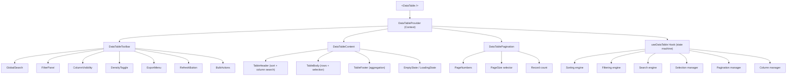

# Enterprise-Grade DataTable Component

Build a single, highly reusable `<DataTable />` component that replaces all existing ad-hoc table implementations across the AuthPay application with one standard, configuration-driven data table.

## User Review Required

> [!IMPORTANT]
> **Phased Delivery**: This is a massive component (~4,000+ lines across ~20 files). The plan is split into 4 phases. I recommend building **Phase 1 + Phase 2** first (core table + toolbar/search/filters/pagination/selection/bulk actions/export), then iterating with Phase 3 (advanced features) and Phase 4 (migration). Do you want me to build all phases in one go, or pause for review after Phase 2?

> [!WARNING]
> **No new npm dependencies**: The plan uses zero new packages. All features (virtual scrolling, export, advanced filters) are built from scratch using existing ShadCN primitives + Tailwind + Lucide icons. If you'd prefer to use a library like TanStack Table under the hood for the headless state management layer, let me know and I'll adjust.

> [!IMPORTANT]
> **Existing table.tsx preserved**: The current [table.tsx](file:///d:/Pratik/Dev/Projects/AuthPay/src/components/ui/table.tsx) low-level primitives (`Table`, `TableRow`, `TableCell`, etc.) will be **kept as-is** and used internally by the new `DataTable`. No breaking changes to existing code until Phase 4 migration.

## Open Questions

> [!IMPORTANT]
> **Server-side API contract**: The plan assumes server-side endpoints accept this query shape:
> ```
> GET /api/...?page=1&pageSize=25&search=john&sort=name:asc&filter[status]=active,pending
> ```
> And return: `{ data: T[], total: number }`. Does this match your existing API patterns, or should I adapt to a different contract?

> [!IMPORTANT]
> **URL sync scope**: URL synchronization (search/filters/sort/page in query params) is planned for Phase 3. Should all DataTable instances sync to URL by default, or only when explicitly opted in via `urlSync` prop?

> [!IMPORTANT]
> **Migration priority**: Which existing tables should be migrated first in Phase 4? Candidates:
> - [AdminUsersPage.tsx](file:///d:/Pratik/Dev/Projects/AuthPay/src/components/admin/AdminUsersPage.tsx) (1,348 lines, most complex)
> - [Transactions.tsx](file:///d:/Pratik/Dev/Projects/AuthPay/src/components/admin/Transactions.tsx) (1,408 lines)
> - [RazorPay.tsx](file:///d:/Pratik/Dev/Projects/AuthPay/src/components/admin/RazorPay.tsx) (2,548 lines, largest)
> - [AdminRolesPage.tsx](file:///d:/Pratik/Dev/Projects/AuthPay/src/components/admin/AdminRolesPage.tsx)
> - [AdminPoliciesPage.tsx](file:///d:/Pratik/Dev/Projects/AuthPay/src/components/admin/AdminPoliciesPage.tsx)
> - [RefundRequests.tsx](file:///d:/Pratik/Dev/Projects/AuthPay/src/components/admin/RefundRequests.tsx)

---

## Architecture Overview



### File Structure

```
src/components/ui/data-table/
├── index.ts                          # Public API barrel export
├── types.ts                          # All TypeScript interfaces & types
├── constants.ts                      # Default configs, page sizes, etc.
├── DataTable.tsx                     # Main component (orchestrator)
├── DataTableProvider.tsx             # React Context provider
├── hooks/
│   ├── useDataTable.ts               # Core state management hook
│   ├── useDataTableSort.ts           # Sorting logic
│   ├── useDataTableFilter.ts         # Filtering logic  
│   ├── useDataTableSearch.ts         # Global + column search (debounced)
│   ├── useDataTableSelection.ts      # Row selection logic
│   ├── useDataTablePagination.ts     # Pagination logic
│   ├── useDataTableColumns.ts        # Column visibility/ordering/resize
│   └── useDataTablePersistence.ts    # State persistence (localStorage/URL)
├── components/
│   ├── DataTableToolbar.tsx           # Top toolbar (search, filters, actions)
│   ├── DataTableContent.tsx           # Table body renderer
│   ├── DataTableHeader.tsx            # Header row (sorting indicators, column search)
│   ├── DataTableRow.tsx               # Individual row (selection, expansion, actions)
│   ├── DataTablePagination.tsx        # Bottom pagination bar
│   ├── DataTableColumnSearch.tsx      # Per-column search inputs
│   ├── DataTableFilterPanel.tsx       # Filter dropdown/panel
│   ├── DataTableColumnVisibility.tsx  # Column show/hide panel
│   ├── DataTableBulkActions.tsx       # Bulk action bar
│   ├── DataTableExport.tsx            # Export menu (CSV, JSON, clipboard)
│   ├── DataTableEmptyState.tsx        # Empty/error/no-results states
│   ├── DataTableLoadingState.tsx      # Skeleton/spinner loading states
│   ├── DataTableDensityToggle.tsx     # Compact/normal/comfortable density
│   └── DataTableActionMenu.tsx        # Row-level action dropdown
└── utils/
    ├── formatters.ts                  # Date, currency, boolean formatters
    ├── export-utils.ts                # CSV/JSON/clipboard export logic
    └── filter-utils.ts                # Filter operator logic
```

---

## Proposed Changes

### Phase 1 — Foundation (Types, Context, Core Hook, Basic Table Rendering)

---

#### [NEW] [types.ts](file:///d:/Pratik/Dev/Projects/AuthPay/src/components/ui/data-table/types.ts)

All TypeScript interfaces for the entire DataTable system. Key types:

```typescript
// Column Definition
interface DataTableColumn<T> {
  id: string;
  header: string | React.ReactNode;
  accessorKey?: keyof T & string;
  accessorFn?: (row: T) => unknown;
  cell?: (props: { row: T; value: unknown }) => React.ReactNode;
  
  // Behavior flags
  sortable?: boolean;
  searchable?: boolean;
  filterable?: boolean;
  hideable?: boolean;
  resizable?: boolean;
  
  // Display
  width?: number;
  minWidth?: number;
  maxWidth?: number;
  align?: 'left' | 'center' | 'right';
  sticky?: 'left' | 'right';
  
  // Rendering helpers
  format?: 'date' | 'currency' | 'boolean' | 'badge' | 'avatar';
  formatOptions?: Record<string, unknown>;
  copyOnClick?: boolean;
  tooltip?: boolean | ((row: T) => string);
  
  // Filter config
  filterType?: 'text' | 'number' | 'date' | 'select' | 'multi-select' | 'boolean';
  filterOptions?: { label: string; value: string }[];
  filterOperators?: string[];
}

// DataTable Props
interface DataTableProps<T> {
  columns: DataTableColumn<T>[];
  data?: T[];
  
  // Server-side
  serverSide?: boolean;
  fetchData?: (params: FetchParams) => Promise<FetchResponse<T>>;
  
  // Feature flags
  searchable?: boolean;
  columnSearch?: boolean;
  selectable?: boolean | 'single' | 'multiple';
  pagination?: boolean;
  filters?: boolean;
  export?: boolean | ExportFormat[];
  refresh?: boolean;
  density?: boolean;
  stickyHeader?: boolean;
  
  // Config
  pageSize?: number;
  pageSizeOptions?: number[];
  persistState?: boolean | string;
  idField?: keyof T & string;
  
  // Bulk actions
  bulkActions?: BulkAction<T>[];
  
  // Row actions
  actions?: RowAction<T>[];
  
  // Permissions
  permissions?: DataTablePermissions;
  
  // Events
  onRowClick?: (row: T) => void;
  onSelectionChange?: (rows: T[]) => void;
  onSortChange?: (sort: SortState[]) => void;
  onFilterChange?: (filters: FilterState[]) => void;
  onSearchChange?: (search: string) => void;
  onPageChange?: (page: number, pageSize: number) => void;
  onRefresh?: () => void;
  
  // Custom renderers
  toolbar?: React.ReactNode | ((props: ToolbarProps) => React.ReactNode);
  emptyState?: React.ReactNode;
  loadingState?: React.ReactNode;
  footer?: React.ReactNode;
  
  // Styling
  className?: string;
  rowClassName?: string | ((row: T) => string);
}
```

---

#### [NEW] [constants.ts](file:///d:/Pratik/Dev/Projects/AuthPay/src/components/ui/data-table/constants.ts)

Default configuration values: page size options `[10, 25, 50, 100, 250, 500]`, default debounce `300ms`, density sizes, default filter operators per type.

---

#### [NEW] [DataTableProvider.tsx](file:///d:/Pratik/Dev/Projects/AuthPay/src/components/ui/data-table/DataTableProvider.tsx)

React Context that holds and distributes all DataTable state:
- Current data (processed/raw)
- Sort state, filter state, search state
- Selection state
- Pagination state
- Column visibility/ordering
- Loading state
- Density setting

All child components read from this context rather than prop-drilling.

---

#### [NEW] [hooks/useDataTable.ts](file:///d:/Pratik/Dev/Projects/AuthPay/src/components/ui/data-table/hooks/useDataTable.ts)

The master orchestrator hook that composes all sub-hooks and manages the data pipeline:

```
Raw Data → Search → Filter → Sort → Paginate → Rendered Rows
```

For server-side mode, instead of running the pipeline locally, it sends parameters to `fetchData()` and returns the server response directly. Uses `useMemo` heavily for performance.

---

#### [NEW] [hooks/useDataTableSort.ts](file:///d:/Pratik/Dev/Projects/AuthPay/src/components/ui/data-table/hooks/useDataTableSort.ts)

Manages single and multi-column sort state. Cycles: `asc → desc → none`. For client-side, sorts in-memory with `localeCompare` for strings, numeric comparison for numbers, `Date` comparison for dates.

---

#### [NEW] [hooks/useDataTableSearch.ts](file:///d:/Pratik/Dev/Projects/AuthPay/src/components/ui/data-table/hooks/useDataTableSearch.ts)

Global search with configurable debounce. Searches all columns marked `searchable: true`. Also manages per-column search state. Supports text highlight matching.

---

#### [NEW] [hooks/useDataTablePagination.ts](file:///d:/Pratik/Dev/Projects/AuthPay/src/components/ui/data-table/hooks/useDataTablePagination.ts)

Manages current page, page size, total count. Auto-resets to page 1 when filters/search change. Computes `startItem`, `endItem`, `totalPages`.

---

#### [NEW] [DataTable.tsx](file:///d:/Pratik/Dev/Projects/AuthPay/src/components/ui/data-table/DataTable.tsx)

Main component that wires everything together:

```tsx
export function DataTable<T extends Record<string, unknown>>({
  columns, data, serverSide, fetchData, ...props
}: DataTableProps<T>) {
  return (
    <DataTableProvider columns={columns} data={data} {...props}>
      <div className="data-table-root">
        <DataTableToolbar />
        <DataTableContent />
        <DataTablePagination />
      </div>
    </DataTableProvider>
  );
}
```

---

#### [NEW] [components/DataTableContent.tsx](file:///d:/Pratik/Dev/Projects/AuthPay/src/components/ui/data-table/components/DataTableContent.tsx)

Renders the actual `<Table>` using existing ShadCN table primitives from [table.tsx](file:///d:/Pratik/Dev/Projects/AuthPay/src/components/ui/table.tsx). Handles:
- Header rendering with sort indicators
- Row rendering with cell formatting
- Selection checkboxes
- Empty/loading states
- Sticky header support
- Density classes

---

#### [NEW] [components/DataTableHeader.tsx](file:///d:/Pratik/Dev/Projects/AuthPay/src/components/ui/data-table/components/DataTableHeader.tsx)

Renders table header row(s):
- Sortable column headers with chevron indicators (reuses `TableHeadSortable` pattern)
- Column search row (when `columnSearch` is enabled)
- Select-all checkbox

---

#### [NEW] [components/DataTableRow.tsx](file:///d:/Pratik/Dev/Projects/AuthPay/src/components/ui/data-table/components/DataTableRow.tsx)

Renders individual data rows:
- Selection checkbox
- Cell rendering with format helpers (date, currency, boolean, badge, avatar, status chip)
- Click-to-copy
- Tooltip on hover
- Row expansion (Phase 3)
- Action menu column

---

#### [NEW] [utils/formatters.ts](file:///d:/Pratik/Dev/Projects/AuthPay/src/components/ui/data-table/utils/formatters.ts)

Cell value formatting utilities:
- `formatDate(value, format?)` — uses `date-fns` (already installed)
- `formatCurrency(value, currency?, locale?)` — `Intl.NumberFormat`
- `formatBoolean(value)` — ✓/✗ icons
- `renderBadge(value, variant?)` — uses existing `Badge` component
- `renderAvatar(value)` — uses existing `Avatar` component
- `renderStatusChip(value, colorMap?)` — colored status pills

---

#### [NEW] [index.ts](file:///d:/Pratik/Dev/Projects/AuthPay/src/components/ui/data-table/index.ts)

Barrel export:

```typescript
export { DataTable } from './DataTable';
export type { DataTableColumn, DataTableProps, ... } from './types';
```

---

### Phase 2 — Interactive Features (Toolbar, Filters, Selection, Bulk Actions, Export)

---

#### [NEW] [hooks/useDataTableFilter.ts](file:///d:/Pratik/Dev/Projects/AuthPay/src/components/ui/data-table/hooks/useDataTableFilter.ts)

Manages active filter state. Supports operators per filter type:
- **Text**: contains, equals, starts_with, ends_with, not_equals
- **Number**: eq, gt, gte, lt, lte, between
- **Date**: before, after, between
- **Select/Multi-select**: in, not_in
- **Boolean**: eq

For client-side, applies filters to in-memory data. For server-side, sends filter params.

---

#### [NEW] [hooks/useDataTableSelection.ts](file:///d:/Pratik/Dev/Projects/AuthPay/src/components/ui/data-table/hooks/useDataTableSelection.ts)

Row selection manager:
- Single/multi select modes
- Checkbox toggle, Shift+click range, Ctrl+click toggle
- Select all on current page / all filtered / all records
- Clear selection
- Persist selection across pages
- Selection count

---

#### [NEW] [hooks/useDataTableColumns.ts](file:///d:/Pratik/Dev/Projects/AuthPay/src/components/ui/data-table/hooks/useDataTableColumns.ts)

Column visibility and ordering:
- Toggle column visibility
- Drag-to-reorder columns
- Reset to default
- Search columns by name

---

#### [NEW] [components/DataTableToolbar.tsx](file:///d:/Pratik/Dev/Projects/AuthPay/src/components/ui/data-table/components/DataTableToolbar.tsx)

Top toolbar that conditionally renders based on enabled features:

```
┌─────────────────────────────────────────────────────────────────┐
│ 🔍 [Search...]  [Filters ▾]  [Columns ▾]  [Density]  [⟳]  [↓]│
│                                                                 │
│ ⚡ 15 items selected  [Delete] [Export] [Archive]  [Clear]      │
└─────────────────────────────────────────────────────────────────┘
```

---

#### [NEW] [components/DataTableFilterPanel.tsx](file:///d:/Pratik/Dev/Projects/AuthPay/src/components/ui/data-table/components/DataTableFilterPanel.tsx)

Filter panel dropdown (uses ShadCN `Popover`):
- Lists all filterable columns
- Each filter renders appropriate input type based on `filterType`
- Active filter count shown as badge on trigger button
- "Clear all filters" button
- Multi-select checkbox lists for enum-like columns

---

#### [NEW] [components/DataTableColumnVisibility.tsx](file:///d:/Pratik/Dev/Projects/AuthPay/src/components/ui/data-table/components/DataTableColumnVisibility.tsx)

Column visibility dropdown (uses ShadCN `Popover`):
- Checkbox list of all `hideable` columns
- Search to find columns
- "Reset to default" button
- Show column count badge

---

#### [NEW] [components/DataTableBulkActions.tsx](file:///d:/Pratik/Dev/Projects/AuthPay/src/components/ui/data-table/components/DataTableBulkActions.tsx)

Shown when rows are selected:
- "{n} items selected" indicator
- Action buttons defined via `bulkActions` prop
- Each action gets `onClick(selectedRows)`
- Supports icons (Lucide)
- "Clear selection" button

---

#### [NEW] [components/DataTableExport.tsx](file:///d:/Pratik/Dev/Projects/AuthPay/src/components/ui/data-table/components/DataTableExport.tsx)

Export dropdown menu:
- **CSV** — extends existing [export.ts](file:///d:/Pratik/Dev/Projects/AuthPay/src/lib/utils/export.ts) `downloadCSV`
- **JSON** — `JSON.stringify` + blob download
- **Clipboard** — `navigator.clipboard.writeText` (tab-separated)
- Scope: current view / selected rows / all filtered rows
- Uses ShadCN `DropdownMenu`

---

#### [NEW] [utils/export-utils.ts](file:///d:/Pratik/Dev/Projects/AuthPay/src/components/ui/data-table/utils/export-utils.ts)

Export functions for CSV, JSON, and clipboard formats. CSV implementation mirrors [export.ts](file:///d:/Pratik/Dev/Projects/AuthPay/src/lib/utils/export.ts) but enhanced to respect visible columns and column headers.

---

#### [NEW] [utils/filter-utils.ts](file:///d:/Pratik/Dev/Projects/AuthPay/src/components/ui/data-table/utils/filter-utils.ts)

Filter operator implementations: string matching, numeric comparison, date range checks. Used by `useDataTableFilter` for client-side filtering.

---

#### [NEW] [components/DataTablePagination.tsx](file:///d:/Pratik/Dev/Projects/AuthPay/src/components/ui/data-table/components/DataTablePagination.tsx)

Enhanced pagination bar (replaces the basic `TablePagination` from table.tsx for DataTable usage):

```
┌─────────────────────────────────────────────────────────────────┐
│ Showing 21-40 of 483 records    Rows: [25 ▾]                   │
│                                                                 │
│ [«] [‹] [1] [2] [3] ... [20] [›] [»]    Jump to: [___]        │
└─────────────────────────────────────────────────────────────────┘
```

Features: First/Last/Prev/Next, page number buttons with ellipsis, jump-to-page input, page size selector with options `[10, 25, 50, 100, 250, 500]`.

---

#### [NEW] [components/DataTableEmptyState.tsx](file:///d:/Pratik/Dev/Projects/AuthPay/src/components/ui/data-table/components/DataTableEmptyState.tsx)

Contextual empty states:
- **No data**: "No records found" with optional icon
- **No search results**: "No results for '{query}'" with clear search button
- **No filter results**: "No records match filters" with clear filters button
- **Error state**: Error message with retry button
- All customizable via props

---

#### [NEW] [components/DataTableLoadingState.tsx](file:///d:/Pratik/Dev/Projects/AuthPay/src/components/ui/data-table/components/DataTableLoadingState.tsx)

Loading states:
- **Skeleton loader**: Rows of animated skeleton blocks matching column layout (using existing `Skeleton` component)
- **Spinner overlay**: Semi-transparent overlay with spinner for server refreshes
- Configurable row count for skeleton

---

#### [NEW] [components/DataTableDensityToggle.tsx](file:///d:/Pratik/Dev/Projects/AuthPay/src/components/ui/data-table/components/DataTableDensityToggle.tsx)

Three density modes: `compact` (py-1), `normal` (py-3), `comfortable` (py-4). Toggle button cycles through modes.

---

#### [NEW] [components/DataTableActionMenu.tsx](file:///d:/Pratik/Dev/Projects/AuthPay/src/components/ui/data-table/components/DataTableActionMenu.tsx)

Row-level action dropdown using ShadCN `DropdownMenu`:
- Built-in actions: View, Edit, Delete, Duplicate, Archive, Restore
- Custom actions via `actions` prop
- Respects `permissions` prop (e.g., hide Delete if `canDelete: false`)

---

#### [NEW] [components/DataTableColumnSearch.tsx](file:///d:/Pratik/Dev/Projects/AuthPay/src/components/ui/data-table/components/DataTableColumnSearch.tsx)

Per-column search inputs rendered in a second header row:
- Text input for text columns
- Number input for number columns
- Date picker for date columns (using existing `Calendar` + `Popover`)
- Select dropdown for select columns
- Debounced by default

---

### Phase 3 — Advanced Features (Persistence, URL Sync, Row Expansion, Grouping, Keyboard, Virtual Scroll)

---

#### [NEW] [hooks/useDataTablePersistence.ts](file:///d:/Pratik/Dev/Projects/AuthPay/src/components/ui/data-table/hooks/useDataTablePersistence.ts)

Persist and restore table state:
- **localStorage**: Filters, sort, pagination, column visibility, density, search
- **URL parameters**: `?page=2&search=john&sort=name:asc&filter[status]=active`
- Uses a `persistKey` string to namespace storage per table instance
- Hydrates state on mount, syncs on every change

---

#### Row Expansion (in [DataTableRow.tsx](file:///d:/Pratik/Dev/Projects/AuthPay/src/components/ui/data-table/components/DataTableRow.tsx))

- Expandable rows with toggle chevron
- `expandedContent` render prop per row
- Accordion mode (only one expanded at a time)
- Nested/tree table support with recursive rendering

---

#### Grouping & Aggregation (in [useDataTable.ts](file:///d:/Pratik/Dev/Projects/AuthPay/src/components/ui/data-table/hooks/useDataTable.ts))

- Group by any column
- Collapsible groups
- Group count and aggregates (sum, avg, min, max, count)
- Footer row with aggregation totals

---

#### Advanced Filter Builder (in [DataTableFilterPanel.tsx](file:///d:/Pratik/Dev/Projects/AuthPay/src/components/ui/data-table/components/DataTableFilterPanel.tsx))

Condition builder UI:
```
Status = Active
AND Created Date > Jan 1
OR Role = Admin
```
Supports AND/OR operators and nested condition groups.

---

#### Keyboard Shortcuts

- `Ctrl+F` → Focus global search
- `Ctrl+Shift+F` → Open advanced filter
- `Ctrl+A` → Select all
- `Esc` → Clear selection
- Arrow keys → Navigate rows
- `Enter` → Row action / expand

---

#### Virtual Scrolling (in [DataTableContent.tsx](file:///d:/Pratik/Dev/Projects/AuthPay/src/components/ui/data-table/components/DataTableContent.tsx))

For datasets > 1000 rows, implement row virtualization:
- Only render visible rows + buffer
- Calculate row heights and scroll position
- Custom `useVirtualScroll` hook
- Falls back to standard rendering for small datasets

---

#### Auto Refresh (in [useDataTable.ts](file:///d:/Pratik/Dev/Projects/AuthPay/src/components/ui/data-table/hooks/useDataTable.ts))

- Manual refresh button
- Optional auto-refresh with configurable polling interval
- Refresh indicator in toolbar

---

#### Responsive / Mobile (in [DataTableContent.tsx](file:///d:/Pratik/Dev/Projects/AuthPay/src/components/ui/data-table/components/DataTableContent.tsx))

- Column priority system (columns with `priority` are hidden first on smaller screens)
- Card view toggle for mobile breakpoints
- Horizontal scroll with shadow indicators

---

### Phase 4 — Migration of Existing Tables

Once the DataTable component is stable, migrate existing table implementations one at a time:

#### [MODIFY] [AdminUsersPage.tsx](file:///d:/Pratik/Dev/Projects/AuthPay/src/components/admin/AdminUsersPage.tsx)

Replace ~800 lines of manual table/sorting/filtering/pagination code with:
```tsx
<DataTable
  columns={userColumns}
  serverSide
  fetchData={fetchUsers}
  searchable
  columnSearch
  selectable
  pagination
  filters
  export={["csv"]}
  actions={[
    { label: "Edit", icon: Edit, onClick: openEditDialog },
    { label: "Roles", icon: Shield, onClick: openRoleDialog },
    { label: "Delete", icon: Trash2, onClick: openDeleteDialog, permission: "canDelete" }
  ]}
  bulkActions={[
    { label: "Delete", icon: Trash2, onClick: bulkDelete }
  ]}
/>
```

#### [MODIFY] [Transactions.tsx](file:///d:/Pratik/Dev/Projects/AuthPay/src/components/admin/Transactions.tsx)

Replace manual table + date filtering + export logic.

#### [MODIFY] [RazorPay.tsx](file:///d:/Pratik/Dev/Projects/AuthPay/src/components/admin/RazorPay.tsx)

Replace subscription plan tables.

#### [MODIFY] [AdminRolesPage.tsx](file:///d:/Pratik/Dev/Projects/AuthPay/src/components/admin/AdminRolesPage.tsx)

Replace roles table.

#### [MODIFY] [AdminPoliciesPage.tsx](file:///d:/Pratik/Dev/Projects/AuthPay/src/components/admin/AdminPoliciesPage.tsx)

Replace policies table.

#### [MODIFY] [RefundRequests.tsx](file:///d:/Pratik/Dev/Projects/AuthPay/src/components/admin/RefundRequests.tsx)

Replace refund requests table.

---

## Verification Plan

### Automated Tests

No test framework is currently set up in the project for component tests. Verification will be manual.

### Manual Verification

1. **Phase 1 completion**: Render a basic `<DataTable columns={...} data={...} />` on a test page — verify columns render, data displays, empty state works
2. **Phase 2 completion**: Verify each feature individually:
   - Type in global search → rows filter with debounce
   - Click column header → sort toggles asc/desc/none
   - Open filter panel → apply text/select/date filters
   - Toggle column visibility → columns hide/show
   - Select rows → bulk action bar appears with correct count
   - Click export → CSV/JSON file downloads with correct data
   - Change page size → pagination updates correctly
   - Check dark mode → all components render correctly
3. **Phase 3 completion**: URL sync, keyboard shortcuts, expand rows, responsive card view
4. **Phase 4 completion**: Each migrated page renders identically to its original implementation, with no regressions in functionality

### Dev Server Verification

- Run `npm run dev` and navigate to a test page with the DataTable component
- Verify in both light and dark mode
- Test responsive behavior at mobile/tablet/desktop widths
